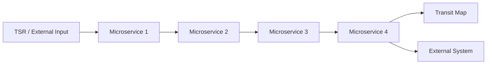
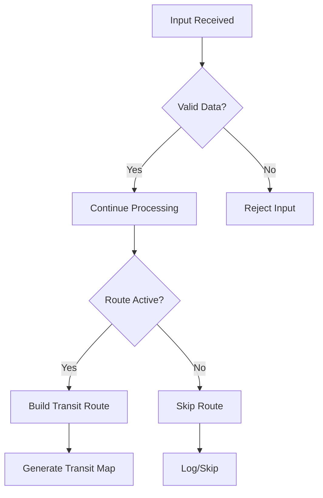
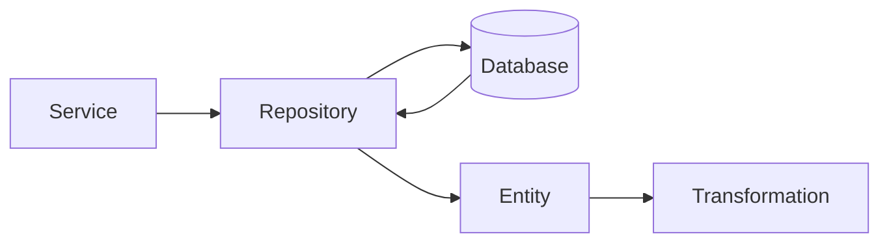
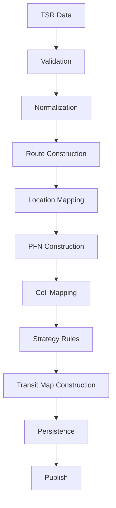
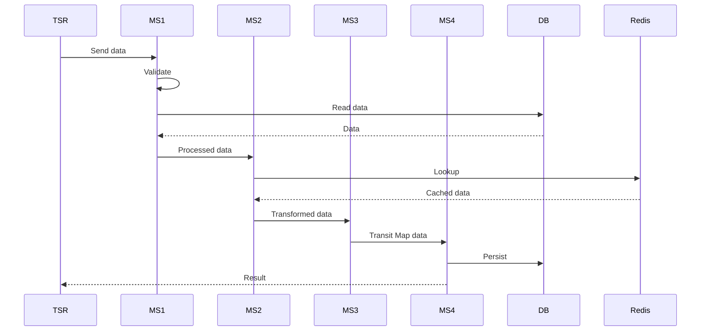

# Role

Act as a **Senior Software Architect / Principal Engineer** performing a complete reverse-engineering and knowledge-transfer analysis of this codebase.

I have **4 microservices** that together implement the NTM functionality.

Your objective is NOT simply to explain individual classes or methods.

Your objective is to reconstruct the **complete end-to-end business and technical flow across all 4 microservices**, starting from the external input and tracing it through every important component until the final output.

I need to become capable of independently understanding, debugging, explaining, and eventually leading this system.

---

# Primary Goal

Analyze the source code and produce a complete **NTM Phase 1 technical + functional knowledge map**.

For every important flow, I need to understand:

1. Where the flow starts
2. What triggers it
3. What input enters the system
4. What parameters/fields are present
5. Which microservice receives it
6. Which controller/API/message listener receives it
7. Which service/component processes it
8. Which database/cache/external system is accessed
9. What transformations happen to the data
10. What validations happen
11. What business rules are applied
12. What conditions/branches exist
13. What happens when parameters have different values
14. What output is produced
15. Where that output goes next
16. How the next microservice consumes it
17. How the complete Transit Map is eventually generated/published
18. What happens when something fails
19. What gets logged/monitored
20. How I can debug the flow in production

Do NOT stop at the first service.

Trace the request/data across the **entire chain of microservices**.

---

# Important Analysis Rules

## 1. Source code is the source of truth

Use the actual source code as the primary source.

Do NOT assume that a class, method, variable, or service behaves a certain way based only on its name.

For every important conclusion, identify:

* File/class
* Method/function
* Relevant code path
* Configuration involved
* Database/query involved
* External dependency involved

If something cannot be determined from the source code, explicitly say:

> "Not determinable from the available source code."

Do not invent behavior.

---

# 2. Start with system discovery

Before analyzing individual flows, first discover the architecture.

Identify all 4 microservices.

For each microservice identify:

* Service name
* Purpose
* Technology/framework
* Entry points
* Controllers
* REST APIs
* Message consumers/listeners
* Scheduled jobs
* Main service classes
* Important components
* Database
* Cache
* External APIs
* Message queues/topics
* Configuration
* Publishing mechanisms
* Dependencies on other microservices

Create an initial architecture diagram.

Use Mermaid.

Example style:



Do not use these exact names unless they exist in the source code.

---

# 3. Build a Microservice Dependency Matrix

Create a table:

| Microservice | Receives From | Sends To | API/Topic | Database | Cache | External Systems | Main Responsibility |
| ------------ | ------------- | -------- | --------- | -------- | ----- | ---------------- | ------------------- |

Identify both synchronous and asynchronous communication.

Clearly distinguish:

* REST
* HTTP
* Kafka/message queue
* Database polling
* Scheduled jobs
* Events
* Direct database access
* Other communication mechanisms

---

# 4. Identify ALL entry points

For every microservice find:

### REST

* Controller
* HTTP method
* URL
* Request object
* Request parameters
* Headers
* Authentication information
* Response object
* HTTP status codes

### Messaging

* Topic/queue
* Consumer/listener
* Message schema
* Producer
* Consumer
* Retry behavior
* Error handling

### Scheduled processes

* Scheduler
* Cron expression
* Trigger conditions
* Input data
* Processing sequence

### Batch/background processing

Identify any asynchronous/background processing.

Create an entry-point table:

| Service | Entry Point | Trigger | Input | Output | Next Component |
| ------- | ----------- | ------- | ----- | ------ | -------------- |

---

# 5. Trace each major flow end-to-end

This is the MOST IMPORTANT part.

For every significant flow, perform a complete code trace.

Start with:

External Input
↓
Entry Point
↓
Controller / Listener
↓
Service
↓
Business Logic
↓
Validation
↓
Transformation
↓
Repository
↓
Database
↓
External API / Cache / Queue
↓
Next Microservice
↓
Next Transformation
↓
Final Output

Do not stop after describing one class.

Continue tracing until the business flow reaches its final meaningful output.

---

# 6. Data Lineage

For every important object/data structure, trace its lifecycle.

For example:

```text
TSR Input
   ↓
TSRRequest
   ↓
Validation
   ↓
NormalizedTSRData
   ↓
TransitRoute
   ↓
PFN
   ↓
Cell
   ↓
TransitMap
   ↓
PublishedTransitMap
```

For every transformation explain:

### Input

What exactly enters the method?

Example:

```json
{
  "source": "...",
  "destination": "...",
  "scheduleDate": "...",
  "routeType": "..."
}
```

### Processing

Explain exactly what happens.

For example:

* Field A is copied to field B
* Field C is converted from String to Date
* Records are grouped by X
* Records are filtered when condition Y is false
* Duplicate records are removed
* Database values are merged
* Default value is applied
* Another service is called

### Output

Show the resulting object/data structure.

Whenever possible provide simplified examples.

---

# 7. Parameter-by-Parameter Analysis

For every important API/request/event identify:

| Parameter | Type | Required? | Default | Used By | Transformation | Business Meaning |
| --------- | ---- | --------- | ------- | ------- | -------------- | ---------------- |

Then explain what happens when the parameter changes.

For example:

### Parameter: routeStatus

If:

```text
routeStatus = ACTIVE
```

Explain the exact code path.

If:

```text
routeStatus = INACTIVE
```

Explain the exact code path.

If:

```text
routeStatus = null
```

Explain what happens.

If:

```text
routeStatus = unexpected value
```

Explain what happens.

Do this for every parameter that materially affects processing.

---

# 8. Conditional Logic / Decision Tree

Find all important:

* if/else
* switch
* filters
* predicates
* validation rules
* feature flags
* configuration-driven behavior
* null checks
* exception branches
* retry logic
* fallback logic

Convert important business logic into decision trees.

Example:



For each decision explain:

* What condition is checked
* Where it is checked
* What happens for TRUE
* What happens for FALSE
* What happens for NULL/empty
* What happens for unexpected values

---

# 9. Business Rules

Separate technical implementation from business behavior.

Create:

## Business Rules

For each rule:

```text
Rule:
Source:
Class:
Method:
Condition:
Action:
Result:
```

Example:

```text
Rule:
Only valid 1P records are processed.

Condition:
record.type == "1P"

Action:
Process record.

Otherwise:
Skip record and increment skipped metric.
```

Only document rules that can be supported by the source code.

---

# 10. Database Analysis

For every database interaction identify:

* Database
* Schema
* Table/collection
* Entity
* Repository
* Query
* Stored procedure if any
* Read/write operation
* Input parameters
* Returned data
* Transformation after retrieval
* Transaction boundaries
* Error handling

Build a data-flow diagram.

Example:



Also identify:

* Which tables are source-of-truth
* Which tables are intermediate
* Which tables are generated/output data

Only make these classifications when supported by code/configuration.

---

# 11. Cache Analysis

Identify:

* Redis/cache usage
* Cache keys
* Cache values
* TTL
* Read path
* Write path
* Cache miss behavior
* Cache invalidation
* Fallback to database
* Whether cache affects correctness or only performance

Explain:

```text
Request
 ↓
Cache lookup
 ↓
Hit → use cached value
 ↓
Miss → database
 ↓
Store result in cache
 ↓
Return result
```

If Redis is not used in a particular flow, explicitly state that.

---

# 12. External System Analysis

Identify every external dependency.

For each:

| System | Why Called | Endpoint/Topic | Input | Output | Failure Behavior | Retry |
| ------ | ---------- | -------------- | ----- | ------ | ---------------- | ----- |

Trace calls across microservices.

Do not assume an external system's behavior beyond what the source code demonstrates.

---

# 13. Transit Map Generation

This requires special attention.

Trace exactly how the system builds the Transit Map.

Explain:

1. What input data is received
2. How source/destination locations are identified
3. How schedules are interpreted
4. How routes are created
5. How locations are connected
6. How Cell is determined
7. How PFN is determined
8. How Strategy ID is used
9. What other attributes are involved
10. How multiple records are combined
11. How duplicates are handled
12. How invalid records are handled
13. How the final Transit Map object is created
14. Where it is stored
15. Where it is published
16. Which downstream service consumes it

Create a dedicated Mermaid diagram:



Replace every placeholder with the actual implementation discovered in the source code.

---

# 14. Cross-Microservice Sequence Diagram

Create a Mermaid sequence diagram for every major end-to-end flow.

Example:



Again, replace this with the actual source-code flow.

---

# 15. Error and Failure Flows

Do not only analyze the happy path.

Identify what happens when:

* Input is invalid
* Required parameter is missing
* Parameter is null
* Database is unavailable
* Database query returns no data
* External API fails
* Timeout occurs
* Message processing fails
* Duplicate message arrives
* Cache is unavailable
* Transit Map generation fails
* Publishing fails
* Partial processing occurs

For each:

| Failure | Where Detected | Exception/Error | Retry? | Recovery | Final Result | Monitoring |
| ------- | -------------- | --------------- | ------ | -------- | ------------ | ---------- |

Create Mermaid failure-flow diagrams for important failures.

---

# 16. Observability

Trace all:

* Logs
* Metrics
* Counters
* Timers
* Traces
* Health checks
* Actuator endpoints
* Prometheus metrics
* Grafana-related metrics
* Dynatrace instrumentation
* Error messages

For every important business operation identify:

```text
Operation
↓
Metric generated
↓
Metric name
↓
Labels/tags
↓
When incremented
↓
When failed
↓
Where visible
```

Pay particular attention to:

* Transit Map generation success/failure
* Processing counts
* Skipped records
* Database connectivity
* Request/response metrics
* HTTP 4xx/5xx
* Processing failures
* Coverage anomalies

---

# 17. Configuration Analysis

Analyze:

* application.yml
* application.properties
* environment variables
* Helm charts
* Kubernetes manifests
* ConfigMaps
* Secrets references
* Feature flags
* Profiles
* Runtime configuration

For each important configuration parameter explain:

| Configuration | Default | Used By | Effect |
| ------------- | ------- | ------- | ------ |

Then explain how changing it changes application behavior.

---

# 18. "What happens if I change X?" Analysis

For every major input, configuration, and business parameter identify its impact.

Use this format:

### Input X

```text
Current value:
...
```

If changed:

```text
New value:
...
```

Trace:

```text
Input
 ↓
Class A
 ↓
Method B
 ↓
Condition C
 ↓
Branch D
 ↓
Output
```

Explain the behavioral difference.

This section is extremely important because I need to be able to debug unexpected production behavior.

---

# 19. Debugging Guide

For every major flow provide a practical debugging procedure.

Example:

### Problem: Transit Map was not generated

Check in this order:

1. Was TSR input received?
2. Check which service received it.
3. Check validation logs.
4. Check validation failure metrics.
5. Check database query.
6. Check transformation.
7. Check route construction.
8. Check Cell/PFN generation.
9. Check Transit Map generation.
10. Check persistence.
11. Check publishing.
12. Check downstream service.

For each step give:

* Class
* Method
* Log/metric
* Database query/table
* Expected result
* Failure indication

---

# 20. Production Incident Scenarios

Create at least 10 realistic troubleshooting scenarios based ONLY on the source code.

For example:

### Scenario 1

TSR sends data but Transit Map is not generated.

### Scenario 2

Transit Map generation succeeds but output is incomplete.

### Scenario 3

Records are unexpectedly skipped.

### Scenario 4

Database connection failures occur.

### Scenario 5

One microservice receives data but the next microservice does not.

### Scenario 6

A particular route is missing.

### Scenario 7

Changing a schedule/date causes different Transit Map output.

### Scenario 8

Duplicate data is received.

### Scenario 9

Publishing succeeds partially.

### Scenario 10

Service returns HTTP 500.

For each scenario explain exactly where I should start debugging.

---

# 21. Code Navigation Map

Create a practical map that tells me:

```text
If I want to understand X
        ↓
Open this class
        ↓
Go to this method
        ↓
Then follow this method
        ↓
Then inspect this repository
        ↓
Then inspect this event/API
```

Create a table:

| Functionality | Starting Class | Starting Method | Next Class | Important Files |
| ------------- | -------------- | --------------- | ---------- | --------------- |

This should allow me to navigate the repository quickly.

---

# 22. Mermaid Diagram Requirements

Create Mermaid diagrams for:

1. Overall architecture
2. Microservice dependencies
3. Main end-to-end flow
4. Transit Map generation
5. Data transformation
6. Database interaction
7. Important business decisions
8. Error flow
9. Message/event flow
10. Deployment/runtime flow if source supports it

Keep diagrams readable.

Do not create one enormous unreadable diagram.

Use multiple focused diagrams.

---

# 23. Output Structure

Produce the final analysis in this exact structure:

# 1. Executive Summary

Explain the complete system in simple language.

# 2. Four Microservices

Explain each service and its responsibility.

# 3. Overall Architecture

Include Mermaid diagram.

# 4. Microservice Communication

Include dependency table and Mermaid diagram.

# 5. Entry Points

REST, events, schedulers, batch jobs.

# 6. End-to-End Flow

Step-by-step numbered flow.

# 7. Data Lineage

Show how data changes from input to final output.

# 8. Parameter Analysis

Explain important input parameters.

# 9. Transformation Rules

Explain every important transformation.

# 10. Business Rules

Explain conditions and rules.

# 11. Transit Map Generation

Provide detailed analysis.

# 12. Database Flow

Include tables/entities/queries.

# 13. Cache Flow

Explain Redis/cache behavior.

# 14. External Systems

Explain integrations.

# 15. Error Handling

Explain failure paths.

# 16. Observability

Explain logs, metrics and monitoring.

# 17. Configuration

Explain important configuration.

# 18. What-If Analysis

Explain how changing inputs affects behavior.

# 19. Debugging Guide

Give practical debugging paths.

# 20. Production Scenarios

Provide troubleshooting scenarios.

# 21. Code Navigation Guide

Tell me exactly where to look in the repository.

# 22. Mermaid Diagrams

Collect the important diagrams here as well.

# 23. Knowledge Gaps

Explicitly identify anything that could not be determined from the source.

# 24. Questions I Should Ask the Team

Generate questions that I should ask the existing team to close the remaining functional/business gaps.

---

# 24. VERY IMPORTANT: Do Not Give Shallow Answers

Do NOT say:

> "This service processes TSR data."

Instead explain:

> TSR sends X → Controller A receives Y → Service B validates fields C/D → Repository E queries table F → Result is transformed into object G → Method H groups records by X → PFN is generated → Transit Map builder creates object J → repository persists it → publisher sends event K to Microservice 2.

Every major statement should be traceable to actual source code.

---

# 25. Separate Facts, Inferences and Unknowns

For every important conclusion classify it as:

**SOURCE CONFIRMED**

* Directly visible in source code.

**INFERRED**

* Strong inference based on multiple source-code references.

**UNKNOWN**

* Cannot be determined from the repository.

Never present an inference as a confirmed fact.

---

# 26. Avoid Premature Summarization

First trace the code deeply.

Do not conclude how the system works based only on:

* Class names
* README
* Wiki
* Package names
* Method names

Follow actual method calls and data structures.

---

# 27. Analyze Tests

Tests are extremely valuable.

For every major component inspect:

* Unit tests
* Integration tests
* Contract tests
* Test fixtures
* Sample input
* Expected output

Use tests to identify intended behavior.

Create:

| Test | Input | Expected Output | Business Rule Demonstrated |
| ---- | ----- | --------------- | -------------------------- |

If implementation and tests disagree, explicitly identify the difference rather than silently resolving it.

---

# 28. Analyze Git History When Available

If git history is available, use it only as supporting evidence.

Look for:

* Why a particular transformation exists
* Why a validation exists
* Bug fixes
* Important architecture changes
* Migration from old architecture to new architecture

Do not treat commit messages as proof of current behavior if the current code says otherwise.

---

# 29. Final Knowledge-Test Section

At the end, create a self-assessment quiz for me.

Generate approximately 30 questions divided into:

### Level 1 – Basic

Architecture and terminology.

### Level 2 – Flow

Trace requests/data through the system.

### Level 3 – Deep Technical

Classes, methods, transformations and database interactions.

### Level 4 – Debugging

Production issue scenarios.

### Level 5 – Lead-Level

Ask questions that test whether I can explain the complete system to another engineer.

Do NOT provide answers immediately.

After the questions, provide a separate answer key based on the source code.

---

# 30. Final Goal

After reading your analysis, I should be able to answer questions such as:

* "What happens when TSR sends this data?"
* "Which microservice receives it?"
* "Which API/event receives it?"
* "What parameters are required?"
* "Where is validation performed?"
* "What happens if this parameter changes?"
* "Where is the data transformed?"
* "Where is the database accessed?"
* "What happens on a cache miss?"
* "How is PFN created?"
* "How is Cell determined?"
* "How is Strategy ID used?"
* "How is the Transit Map constructed?"
* "Where is it stored?"
* "Where is it published?"
* "Which service consumes the output?"
* "Why was this record skipped?"
* "Why did Transit Map generation fail?"
* "Which logs should I check?"
* "Which metrics should I check?"
* "Which class/method should I debug?"
* "What happens if the database is unavailable?"
* "What happens if TSR sends incomplete data?"
* "How does the old ARC flow differ from the new NTM flow?"
* "How can I explain the complete NTM architecture to another engineer?"

The final output should therefore function as my **NTM Phase 1 reverse-engineering document, technical KT, data-flow reference, debugging guide, and preparation material for my knowledge evaluation**.

Start by discovering the repository structure and identifying the four microservices. Do not start with assumptions.


Use this in phases:

Phase 1 → Architecture discovery

Identify the 4 microservices, dependencies, entry points, databases, queues, external systems and major components.

Phase 2 → Flow tracing

Trace one complete business flow across all 4 services, method by method.

Phase 3 → Data lineage

For every major object, show input → transformation → output.

Phase 4 → What-if analysis

Pick every important parameter and explain how changing it changes the flow.

Phase 5 → Failure/debugging

Trace failures and tell me exactly where I would debug them.

Phase 6 → Mermaid

Generate architecture, sequence, data-flow and decision diagrams.

Phase 7 → KT preparation

Quiz me like my manager would, especially on TSR → NTM → Transit Map → publishing.
